# Proyecto 2 – Búsqueda de llaves DES por fuerza bruta con MPI

**Curso:** Computación Paralela · Universidad del Valle de Guatemala · Segundo ciclo 2026

**Integrantes:** _(completar)_

---

## Índice

1. [El algoritmo DES](#1-el-algoritmo-des)
2. [Diagrama de flujo de DES](#2-diagrama-de-flujo-de-des)
3. [Compilación y ejecución de `bruteforce_.c`](#3-compilación-y-ejecución-de-bruteforce_c)
4. [Texto cifrado](#4-texto-cifrado)
5. [Funcionamiento del programa](#5-funcionamiento-del-programa)
6. [Medición de tiempos](#6-medición-de-tiempos)
7. [Impacto de la llave en el reparto de la búsqueda](#7-impacto-de-la-llave-en-el-reparto-de-la-búsqueda)
8. [Conclusiones](#8-conclusiones)

---

## 1. El algoritmo DES

DES (*Data Encryption Standard*) es un cifrador simétrico por bloques publicado como
estándar federal de EE. UU. en 1977 (FIPS 46). "Simétrico" significa que la misma llave
sirve para cifrar y para descifrar; "por bloques" significa que procesa el mensaje en
trozos de tamaño fijo.

| Parámetro | Valor |
|---|---|
| Tamaño de bloque | 64 bits (8 bytes) |
| Tamaño de llave | 64 bits, de los cuales 56 son efectivos y 8 son de paridad |
| Estructura | Red de Feistel de 16 rondas |
| Subllaves | 16 subllaves de 48 bits, una por ronda |

### 1.1 Pasos para cifrar un bloque de 64 bits

1. **Permutación inicial (IP).** Los 64 bits del bloque se reordenan según una tabla
   fija. No aporta seguridad; facilitaba la implementación en el hardware de la época.
2. **División.** El bloque permutado se parte en dos mitades de 32 bits: L₀ (izquierda)
   y R₀ (derecha).
3. **16 rondas de Feistel.** En la ronda *i* (i = 1…16):
   - Lᵢ = Rᵢ₋₁
   - Rᵢ = Lᵢ₋₁ ⊕ f(Rᵢ₋₁, Kᵢ)

   donde ⊕ es XOR y *f* es la función de ronda descrita abajo.
4. **Intercambio final.** Tras la ronda 16 se concatenan las mitades invertidas: R₁₆L₁₆.
5. **Permutación final (FP = IP⁻¹).** Se aplica la permutación inversa de la inicial; el
   resultado es el bloque cifrado.

### 1.2 La función de ronda *f*(R, K)

1. **Expansión E:** los 32 bits de R se expanden a 48 duplicando 16 de ellos.
2. **Mezcla con la llave:** el resultado se combina con la subllave Kᵢ (48 bits) mediante XOR.
3. **Sustitución (S-boxes):** los 48 bits se dividen en 8 grupos de 6. Cada grupo entra a
   su propia caja S: los bits extremos eligen la fila (0–3) y los 4 centrales la columna
   (0–15) de una tabla, que devuelve 4 bits. Salen 8 × 4 = 32 bits. Las S-boxes son la
   única parte **no lineal** de DES y la principal fuente de su seguridad.
4. **Permutación P:** los 32 bits se reordenan con una tabla fija para dispersar la salida
   de cada S-box hacia varias S-boxes de la ronda siguiente.

### 1.3 Generación de subllaves (*key schedule*)

1. **PC-1:** de los 64 bits de la llave se descartan los 8 bits de paridad (bits 8, 16, …, 64)
   y los 56 restantes se permutan.
2. Los 56 bits se dividen en dos mitades de 28 bits, C₀ y D₀.
3. En cada ronda *i*, Cᵢ y Dᵢ se rotan a la izquierda **1 posición** (rondas 1, 2, 9 y 16)
   o **2 posiciones** (las demás).
4. **PC-2:** de los 56 bits de CᵢDᵢ se seleccionan y permutan 48, que forman la subllave Kᵢ.

### 1.4 Descifrado

Por la estructura de Feistel, descifrar es **exactamente el mismo algoritmo** con las
subllaves en orden inverso (K₁₆, K₁₅, …, K₁). Esto funciona aunque *f* no sea invertible,
porque cada ronda solo aplica un XOR con *f*(R, K), y aplicar dos veces el mismo XOR lo
cancela.

### 1.5 Modo de operación ECB

DES cifra un bloque de 8 bytes; para mensajes más largos se necesita un *modo de
operación*. El programa usa **ECB** (*Electronic Code Book*): el texto se parte en bloques
de 8 bytes y cada uno se cifra de forma independiente con la misma llave. Si el texto no
mide un múltiplo de 8, se rellena (aquí, con ceros). ECB es el modo más simple, pero tiene
una debilidad: dos bloques de texto plano iguales producen el mismo bloque cifrado, lo que
filtra patrones del mensaje.

### 1.6 Debilidad: el tamaño de la llave

Con 56 bits efectivos hay 2⁵⁶ ≈ 7.2 × 10¹⁶ llaves posibles. Esto ya era polémico en 1977, y
en 1998 la máquina *Deep Crack* de la EFF encontró una llave DES en 56 horas. Este proyecto
reproduce ese ataque a pequeña escala: probar llaves hasta que el texto descifrado
contenga una frase conocida.

---

## 2. Diagrama de flujo de DES

### 2.1 Cifrado de un bloque

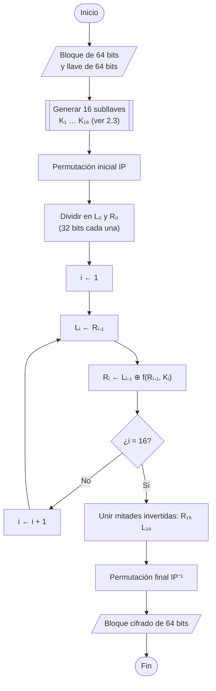

Para **descifrar** se sigue el mismo diagrama usando las subllaves en orden inverso
(en la ronda *i* se usa K₁₇₋ᵢ).

### 2.2 Función de ronda *f*

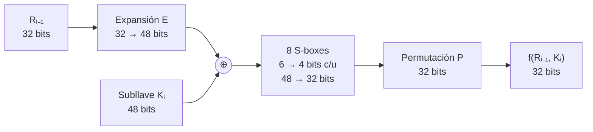

### 2.3 Generación de subllaves

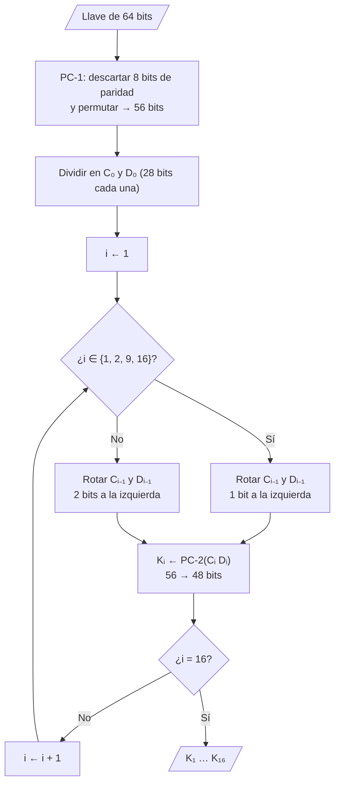

---

## 3. Compilación y ejecución de `bruteforce_.c`

### 3.1 Entorno

| Componente | Versión |
|---|---|
| CPU | Intel Core i7-13700HX: 8 núcleos de rendimiento (con hyper-threading) + 8 de eficiencia, 24 hilos |
| Sistema | Windows 11 + WSL 2.1.5, Ubuntu 24.04.2 LTS |
| Compilador | gcc 13.3.0 (vía `mpicc`) |
| MPI | Open MPI 4.1.6 |
| Biblioteca DES | OpenSSL 3.0.13 (libcrypto) |

### 3.2 Problema de compatibilidad

Al compilar el código entregado, el compilador no encuentra `<rpc/des_crypt.h>`. Ese
header y las funciones `ecb_crypt()` y `des_setparity()` formaban parte de la biblioteca
estándar de C de GNU (glibc), pero **fueron eliminados en glibc 2.32**. Ubuntu 24.04 trae
glibc 2.39. El paquete `libtirpc-dev` instala un header con ese nombre, pero su biblioteca
no exporta esas funciones, por lo que el enlazado falla.

**Solución:** se escribió [compat/rpc/des_crypt.h](compat/rpc/des_crypt.h), que define
`des_setparity()` y `ecb_crypt()` con la misma firma que las originales, implementadas con
las funciones DES de OpenSSL (`DES_set_odd_parity`, `DES_set_key_unchecked`,
`DES_ecb_encrypt`). Al compilar con `-Icompat`, el `#include <rpc/des_crypt.h>` del
programa encuentra este archivo, y **el código original compila sin modificarse**:

```bash
sudo apt install build-essential openmpi-bin libopenmpi-dev libssl-dev
mpicc -O2 -Wall -Icompat bruteforce_.c -o bruteforce_original -lcrypto
mpirun -np 4 ./bruteforce_original
```

```text
Process 0 lower 0 upper 18014398509481983
Process 1 lower 18014398509481984 upper 36028797018963967
Process 2 lower 36028797018963968 upper 54043195528445951
Process 3 lower 54043195528445952 upper 72057594037927936
```

El programa reparte el espacio y empieza a buscar, pero **nunca termina**. Al revisarlo se
encontraron estos defectos:

| # | Defecto | Consecuencia |
|---|---|---|
| 1 | `ecb_crypt(..., 16, ...)` usa una longitud fija de 16 bytes | Solo se cifran los 2 primeros bloques; el resto del texto queda en claro |
| 2 | La frase buscada es `" los mismos del proyecto 1 "` con espacios, pero en el texto aparece como `"(los mismos del proyecto 1)"` | `strstr` nunca encuentra la frase: ninguna llave se acepta |
| 3 | `0xFE << i*8` es una operación sobre `int` (32 bits) | Para i ≥ 4 el corrimiento es de 32 bits o más: comportamiento indefinido en C |
| 4 | `the_key = 2⁵⁴` en un espacio de 2⁵⁶ | Con 1–3 procesos, el proceso 0 tendría que probar ~1.8 × 10¹⁶ llaves (miles de años) |
| 5 | Si nadie encuentra la llave, el proceso 0 espera en `MPI_Wait` | El programa queda bloqueado indefinidamente |
| 6 | `myupper = range_per_node*(id+1) - 1` junto con `i < myupper` | Se salta la última llave del rango de cada proceso |

### 3.3 Versión corregida

[bruteforce.c](bruteforce.c) conserva las funciones `decrypt`, `encrypt` y `tryKey` y el
esquema de comunicación del original, y corrige los seis defectos. Además:

- Lee el texto desde un archivo y acepta la llave, la frase y el tamaño del espacio por
  línea de comandos.
- Solo el proceso 0 lee el texto plano y conoce la llave; distribuye **únicamente el
  texto cifrado** con `MPI_Bcast`, como sucedería entre máquinas distintas.
- Ofrece dos repartos: por **bloques** (el original) y **cíclico**.
- Mide el tiempo de búsqueda con `MPI_Wtime()` y cuenta las llaves probadas.

```bash
make
mpirun -np 4 ./bruteforce -k 123456 -b 20                # reparto por bloques
mpirun -np 4 ./bruteforce -k 123456 -b 20 -m ciclico     # reparto cíclico
```

---

## 4. Texto cifrado

Se eligió un texto propio de **356 palabras** (2 322 bytes en UTF-8) sobre la historia de
DES, guardado en [texto.txt](texto.txt). La frase clave para validar el descifrado es
**`llamada Deep Crack`**, que aparece una sola vez, en el tercer párrafo.

Al rellenar con ceros hasta un múltiplo de 8 se obtienen 2 328 bytes (291 bloques DES).
Cifrado con la llave **123456**:

```bash
mpirun -np 1 ./bruteforce -k 123456 -b 20 -o cifrado.bin
xxd cifrado.bin | head -4
```

```text
00000000: edfc 29c2 e6be c3f3 e82a 653e f1e4 95ef  ..)......*e>....
00000010: 90af c448 3ec0 17d3 cd96 05e4 e6c2 b39c  ...H>...........
00000020: cf6c 9940 1a7e 735c 034a 98e4 9a84 3af8  .l.@.~s\.J....:.
00000030: 4fc6 17ec a0ce 95e2 8e34 8c59 4740 bd8a  O........4.YG@..
```

El texto plano empieza con "El Estándar de Cifrado…"; en el cifrado no queda rastro de él.
La búsqueda recupera la llave y el texto completo:

```text
Proceso 0: llaves [0, 1048576) paso 1
Proceso 0 encontró la llave
Llave = 123456

El Estándar de Cifrado de Datos, conocido por sus siglas en inglés como DES, ...
Tiempo de búsqueda: 4.778338 s, llaves probadas: 123457
```

---

## 5. Funcionamiento del programa

### 5.1 Flujo general del programa con MPI

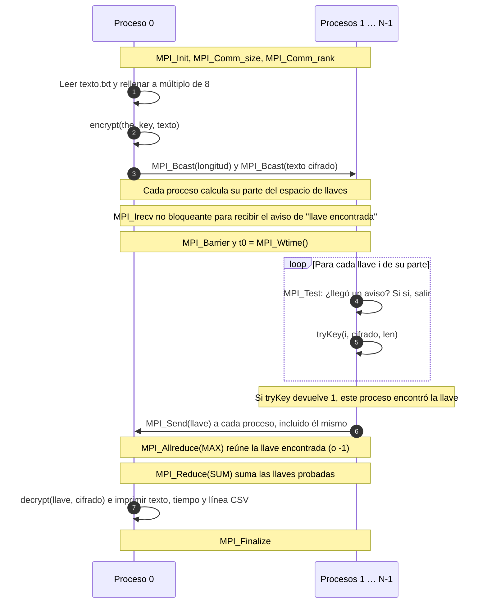

El aviso de "llave encontrada" usa un `MPI_Irecv` **no bloqueante** que cada proceso
publica antes de empezar y revisa con `MPI_Test` en cada iteración. Así ningún proceso se
detiene a esperar mensajes mientras busca. El proceso que encuentra la llave hace un
`MPI_Send` a todos (incluido él mismo), lo que completa el `MPI_Irecv` de cada uno.

### 5.2 `encrypt(key, *ciph, len)` y `decrypt(key, *ciph, len)`

Ambas funciones son idénticas salvo por el modo que pasan a `ecb_crypt`. Tienen tres pasos:

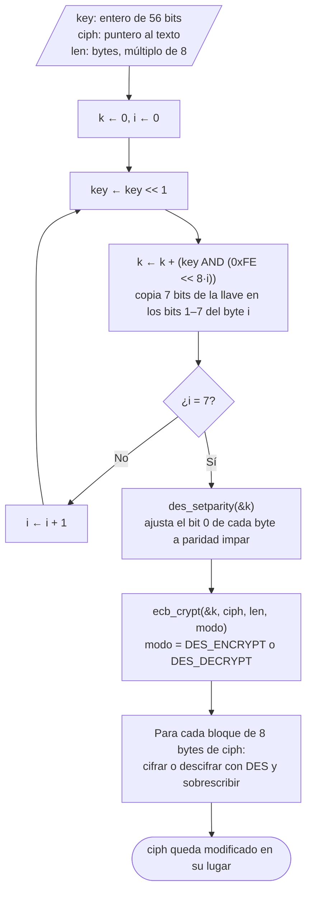

**Paso 1: expansión de la llave de 56 a 64 bits.** DES espera 8 bytes en los que el bit
menos significativo de cada byte es de paridad. El ciclo reparte los 56 bits del número
`key` en grupos de 7: en la iteración *i* la llave ya se desplazó *i*+1 posiciones, así que
la máscara `0xFE << 8i` toma los bits 7i … 7i+6 de la llave original y los coloca en los
bits 1–7 del byte *i*.

```text
key (56 bits):  [ g7 | g6 | g5 | g4 | g3 | g2 | g1 | g0 ]   cada gᵢ = 7 bits
                   │    │    │    │    │    │    │    │
k (64 bits):    [g7 p|g6 p|g5 p|g4 p|g3 p|g2 p|g1 p|g0 p]   p = bit de paridad
                 byte7                          byte0
```

Ejemplo verificado con la llave 123456 (bytes en orden de memoria, byte 0 primero):

| | byte 0 | byte 1 | byte 2 | bytes 3–7 |
|---|---|---|---|---|
| Después del ciclo | `80` | `88` | `0E` | `00` |
| Después de `des_setparity` | `80` | `89` | `0E` | `01` |

Por ejemplo, `0x88 = 10001000₂` tiene dos unos, así que la paridad impar enciende el
bit 0 → `0x89`.

**Paso 2: `des_setparity`.** Ajusta el bit 0 de cada byte para que cada byte tenga un
número impar de unos, como exige el estándar.

**Paso 3: `ecb_crypt`.** Cifra o descifra `len` bytes en modo ECB, **sobrescribiendo** el
mismo arreglo (*in-place*). En la versión corregida se pasa `len`; el original pasaba 16
fijo (defecto 1 de la sección 3.2).

### 5.3 `tryKey(key, *ciph, len)`

`tryKey` responde a la pregunta "¿es `key` la llave correcta?". Devuelve 1 si al descifrar
con esa llave aparece la frase clave, y 0 si no.

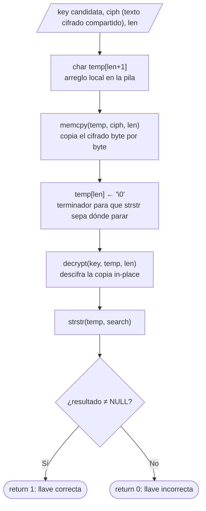

¿Por qué copiar antes de descifrar? `decrypt` sobrescribe el arreglo que recibe. Si se
descifrara `ciph` directamente, cada llave incorrecta destruiría el texto cifrado y la
siguiente llave ya no partiría del cifrado original. La copia en `temp` protege el
original, que se reutiliza en cada una de las millones de llaves.

```text
ciph  (compartido, nunca cambia):  ED FC 29 C2 E6 BE C3 F3 ...  (2328 bytes)
         │ memcpy
         ▼
temp  (copia local):               ED FC 29 C2 E6 BE C3 F3 ... 00
         │ decrypt(key)
         ▼
temp  (llave incorrecta):          9A 11 F0 3B 7C 02 ...        → strstr = NULL → 0
temp  (llave correcta):            "El Estándar de Cifrado..." → strstr ≠ NULL → 1
```

El costo de `tryKey` es casi todo el descifrado: 291 bloques DES más la generación de
subllaves. Por eso cada proceso prueba ~26 800 llaves por segundo en el equipo usado.

### 5.4 `memcpy`

```c
void *memcpy(void *dest, const void *src, size_t n);
```

Copia exactamente `n` bytes desde `src` hacia `dest` y devuelve `dest`. Las regiones no
deben solaparse (para eso existe `memmove`).

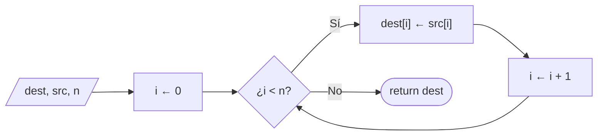

```text
src : [ED][FC][29][00][E6][BE] ...      ← el byte 00 puede aparecer en el cifrado
         ↓   ↓   ↓   ↓   ↓   ↓
dest: [ED][FC][29][00][E6][BE] ...      ← memcpy lo copia igual
```

Detalle importante: `memcpy` **no se detiene en el byte `\0`**, a diferencia de `strcpy`.
El texto cifrado es binario y puede contener bytes cero en cualquier posición; `strcpy` lo
truncaría y la copia quedaría incompleta. Por eso el programa usa `memcpy` con la
longitud explícita. Las implementaciones reales copian por palabras o con instrucciones
vectoriales (SSE/AVX) en vez de byte por byte, pero el resultado es el mismo.

### 5.5 `strstr`

```c
char *strstr(const char *haystack, const char *needle);
```

Busca la primera aparición de la cadena `needle` (aguja) dentro de `haystack` (pajar).
Devuelve un puntero al inicio de la coincidencia, o `NULL` si no la encuentra. Ambas
cadenas terminan en `\0`.

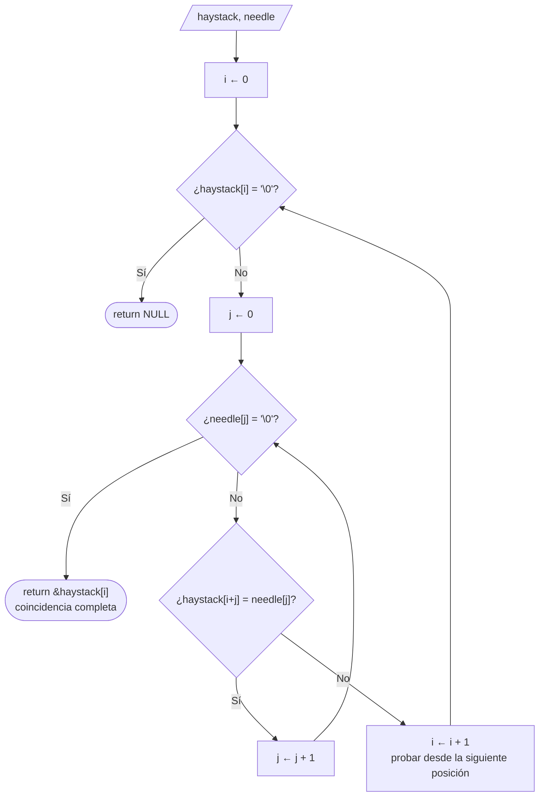

Ejemplo con la frase de este proyecto:

```text
haystack: "... construyó una máquina llamada Deep Crack que encontró ..."
needle:                             "llamada Deep Crack"
                                     ↑ en esta posición coinciden los 18 caracteres → puntero ≠ NULL
```

En `tryKey`, `strstr` es el **criterio de validación**: con una llave incorrecta, DES
produce bytes pseudoaleatorios y la probabilidad de que aparezcan por azar los 18 bytes de
la frase es despreciable (≈ 2328 / 256¹⁸). Si el descifrado erróneo contiene un byte `\0`,
`strstr` deja de buscar ahí, lo cual no afecta el resultado porque esa llave es incorrecta
de todas formas. La versión mostrada es la ingenua, O(n·m); glibc usa el algoritmo
*Two-Way*, que es lineal, pero el resultado es el mismo.

### 5.6 Reparto del espacio de llaves

Con N procesos y un espacio de S = 2ᵇ llaves:

| Reparto | Llaves que prueba el proceso *id* | Código |
|---|---|---|
| Bloques (original) | [id·S/N, (id+1)·S/N), contiguas | `i = mylower; i < myupper; i++` |
| Cíclico | id, id+N, id+2N, … | `i = id; i < S; i += N` |

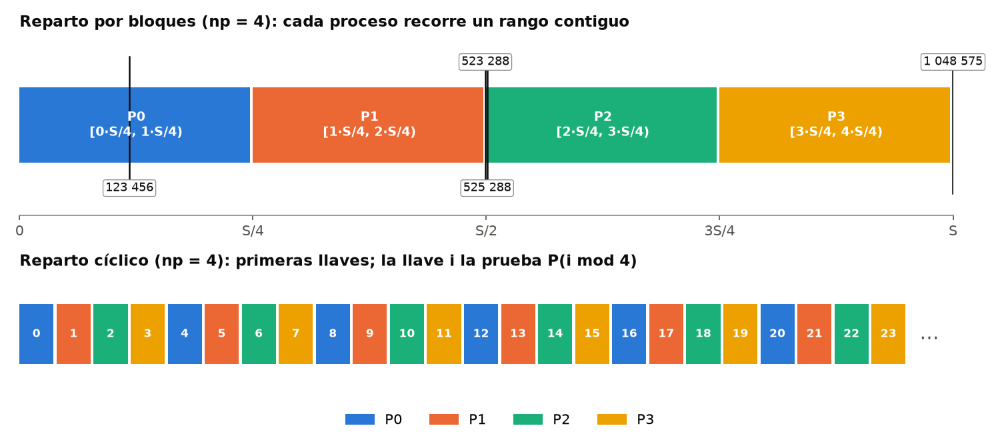

---

## 6. Medición de tiempos

### 6.1 Metodología

- **Espacio de búsqueda:** S = 2²⁰ = 1 048 576 llaves (opción `-b 20`), para que el peor
  caso secuencial tome decenas de segundos y no miles de años.
- **Llaves:** cuatro, elegidas según dónde caen en el reparto por bloques:

  | Llave | Posición | Por qué se eligió |
  |---|---|---|
  | 123 456 | 11.8 % de S | Pequeña: queda en el bloque del proceso 0 para N ≤ 8 |
  | 523 288 | S/2 − 1000 | Justo **antes** de la mitad: final del bloque de un proceso |
  | 525 288 | S/2 + 1000 | Justo **después** de la mitad: inicio del bloque de un proceso |
  | 1 048 575 | S − 1 | La última llave: peor caso secuencial |

- **Procesos:** 1, 2, 4 y 8; repartos por bloques y cíclico. Con 1 proceso ambos repartos
  son idénticos y se mide una sola vez.
- **Repeticiones:** 5 por caso (140 ejecuciones); se reporta el promedio y la desviación
  estándar.
- **Qué se mide:** el tiempo entre un `MPI_Barrier` justo antes de la búsqueda y el
  momento en que todos los procesos conocen la llave (`MPI_Wtime`). No incluye el arranque
  de `mpirun` ni la lectura y el cifrado del texto.
- **Speedup:** Sₚ = T₁ / Tₚ con la **misma llave**; eficiencia Eₚ = Sₚ / p.

Scripts: [medir.sh](medir.sh) ejecuta las mediciones y guarda [resultados.csv](resultados.csv);
[resumen.py](resumen.py) produce la tabla y [graficas.py](graficas.py) las gráficas.

### 6.2 Resultados

| Llave | Reparto | Procesos | Tiempo prom. (s) | Desv. est. (s) | Llaves probadas | Speedup | Eficiencia |
|---:|---|---:|---:|---:|---:|---:|---:|
| 123 456 | — | 1 | 4.6045 | 0.1123 | 123 457 | 1.00 | 1.00 |
| 123 456 | bloques | 2 | 4.4364 | 0.0183 | 247 143 | 1.04 | 0.52 |
| 123 456 | bloques | 4 | 4.6361 | 0.1286 | 494 262 | 0.99 | 0.25 |
| 123 456 | bloques | 8 | 5.9498 | 0.2737 | 989 530 | 0.77 | 0.10 |
| 123 456 | cíclico | 2 | 2.2162 | 0.1155 | 123 724 | 2.08 | 1.04 |
| 123 456 | cíclico | 4 | 1.1532 | 0.0132 | 123 578 | 3.99 | 1.00 |
| 123 456 | cíclico | 8 | 0.7035 | 0.0238 | 122 450 | 6.55 | 0.82 |
| 523 288 | — | 1 | 19.4541 | 0.2545 | 523 289 | 1.00 | 1.00 |
| 523 288 | bloques | 2 | 18.4631 | 0.1745 | 1 046 242 | 1.05 | 0.53 |
| 523 288 | bloques | 4 | 9.7485 | 0.2060 | 1 044 765 | 2.00 | 0.50 |
| 523 288 | bloques | 8 | 6.1505 | 0.1119 | 1 039 542 | 3.16 | 0.40 |
| 523 288 | cíclico | 2 | 9.4225 | 0.1447 | 523 056 | 2.06 | 1.03 |
| 523 288 | cíclico | 4 | 4.8816 | 0.0552 | 522 835 | 3.99 | 1.00 |
| 523 288 | cíclico | 8 | 3.1191 | 0.0457 | 523 899 | 6.24 | 0.78 |
| 525 288 | — | 1 | 19.3269 | 0.2119 | 525 289 | 1.00 | 1.00 |
| 525 288 | bloques | 2 | 0.0387 | 0.0032 | 2 007 | 498.93 | 249.47 |
| 525 288 | bloques | 4 | 0.0374 | 0.0019 | 3 941 | 516.31 | 129.08 |
| 525 288 | bloques | 8 | 0.0474 | 0.0091 | 7 904 | 407.46 | 50.93 |
| 525 288 | cíclico | 2 | 9.4626 | 0.1906 | 525 190 | 2.04 | 1.02 |
| 525 288 | cíclico | 4 | 4.9826 | 0.1372 | 525 251 | 3.88 | 0.97 |
| 525 288 | cíclico | 8 | 3.1239 | 0.0632 | 525 333 | 6.19 | 0.77 |
| 1 048 575 | — | 1 | 38.5211 | 0.2992 | 1 048 576 | 1.00 | 1.00 |
| 1 048 575 | bloques | 2 | 18.8220 | 0.5427 | 1 047 952 | 2.05 | 1.02 |
| 1 048 575 | bloques | 4 | 9.9181 | 0.2732 | 1 048 098 | 3.88 | 0.97 |
| 1 048 575 | bloques | 8 | 6.1883 | 0.1548 | 1 043 614 | 6.22 | 0.78 |
| 1 048 575 | cíclico | 2 | 18.4647 | 0.2248 | 1 048 281 | 2.09 | 1.04 |
| 1 048 575 | cíclico | 4 | 9.7496 | 0.1383 | 1 048 096 | 3.95 | 0.99 |
| 1 048 575 | cíclico | 8 | 6.1369 | 0.2166 | 1 047 089 | 6.28 | 0.78 |

Las desviaciones estándar son menores al 5 % del promedio en casi todos los casos, por lo
que las diferencias entre configuraciones son reales y no ruido de medición.

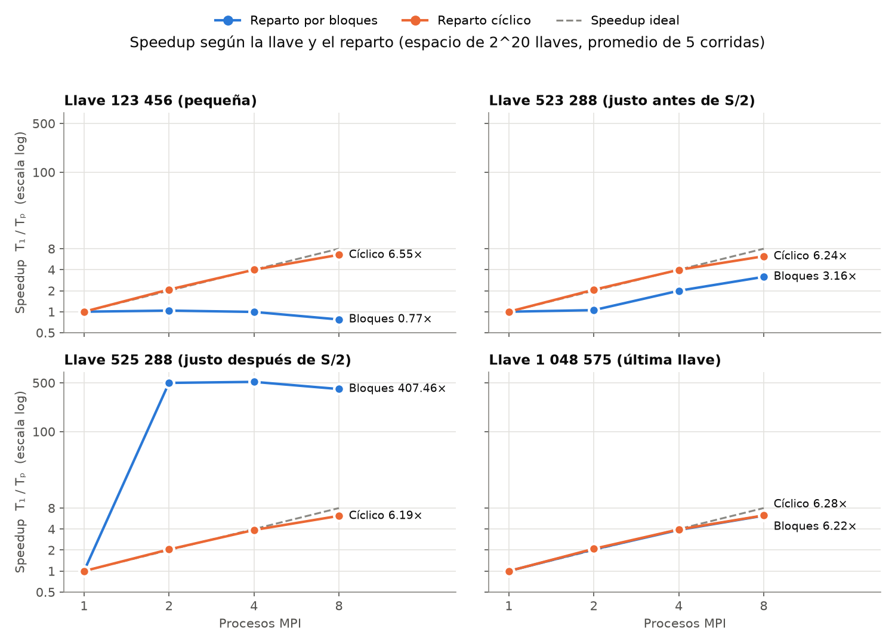

### 6.3 Observaciones directas

- **Velocidad base:** un proceso prueba ≈ 26 800 llaves/s (123 457 llaves en 4.60 s).
  El tiempo secuencial crece linealmente con el valor de la llave: 4.6 s, 19.4 s y 38.5 s
  para 123 456, ~524 000 y 1 048 575.
- **Reparto cíclico:** speedup de 2.0–2.1 con 2 procesos, 3.9–4.0 con 4 y 6.2–6.6 con 8,
  **sin importar la llave**.
- **Reparto por bloques:** el speedup va de **0.77** (más lento que secuencial) a **516**,
  según la llave.
- **8 procesos:** ninguna configuración "normal" pasa de ~6.3×; la eficiencia cae a
  ~0.78 (ver 7.4).

---

## 7. Impacto de la llave en el reparto de la búsqueda

### 7.1 Modelo del tiempo de búsqueda

Sea *v* la velocidad de un proceso (llaves/s) y *k* la llave. En la búsqueda secuencial se
prueban las llaves 0, 1, …, k, así que T₁ = (k+1)/v.

**Reparto por bloques.** El tamaño de bloque es B = S/N y la llave cae en el bloque del
proceso b = ⌊k/B⌋. Todos los procesos avanzan en paralelo a la misma velocidad, así que
el proceso *b* llega a la llave después de probar d = k − b·B llaves (la distancia desde
el inicio de su bloque):

> Tₚ ≈ (d + 1) / v  ⇒  **Sₚ ≈ (k + 1) / (d + 1)**

El speedup **no depende de N directamente**, sino de dónde queda *k* dentro de su bloque:

- Si *k* está al **inicio** de un bloque (d pequeño), Sₚ es enorme ("superlineal").
- Si *k* está en el bloque del **proceso 0** (b = 0, d = k), Sₚ = 1: los demás procesos
  trabajan en rangos donde la llave no está, y su trabajo se desperdicia.
- Si *k* está al **final** de un bloque, d ≈ B y Sₚ ≈ (k+1)/B, que es como mucho N
  (se alcanza con k = S−1).

**Reparto cíclico.** El proceso k mod N prueba la llave *k* en su iteración ⌊k/N⌋:

> Tₚ ≈ (k/N) / v  ⇒  **Sₚ ≈ N**, para cualquier *k*

### 7.2 El modelo frente a las mediciones

| Llave | N | Proceso que la encuentra | Distancia d | Speedup predicho | Speedup medido |
|---:|---:|---:|---:|---:|---:|
| 123 456 | 2 | P0 | 123 456 | 1.00 | 1.04 |
| 123 456 | 4 | P0 | 123 456 | 1.00 | 0.99 |
| 123 456 | 8 | P0 | 123 456 | 1.00 | 0.77 |
| 523 288 | 2 | P0 | 523 288 | 1.00 | 1.05 |
| 523 288 | 4 | P1 | 261 144 | 2.00 | 2.00 |
| 523 288 | 8 | P3 | 130 072 | 4.02 | 3.16 |
| 525 288 | 2 | P1 | 1 000 | 524.76 | 498.93 |
| 525 288 | 4 | P2 | 1 000 | 524.76 | 516.31 |
| 525 288 | 8 | P4 | 1 000 | 524.76 | 407.46 |
| 1 048 575 | 2 | P1 | 524 287 | 2.00 | 2.05 |
| 1 048 575 | 4 | P3 | 262 143 | 4.00 | 3.88 |
| 1 048 575 | 8 | P7 | 131 071 | 8.00 | 6.22 |

El modelo acierta en todos los casos con 2 y 4 procesos. Con 8, los valores medidos son
≈ 0.78 veces los predichos, el mismo factor de eficiencia que se observa en el reparto
cíclico (ver 7.4). Con 525 288, el speedup medido es menor al predicho porque Tₚ es tan
corto (~0.04 s) que pesan los costos fijos: la barrera, los mensajes de aviso y el
`MPI_Allreduce` final.

### 7.3 ¿Qué hace que encontrar la llave sea más rápido o más lento?

1. **Con reparto por bloques, la posición relativa de la llave lo decide todo.** El dato
   que importa no es el valor de la llave sino su distancia al inicio del bloque que la
   contiene:
   - Las llaves 523 288 y 525 288 difieren en solo 2 000 (0.2 % del espacio). Sin embargo,
     con 2 procesos la primera tarda **18.5 s** y la segunda **0.039 s**, porque la
     segunda cae justo al inicio del bloque del proceso 1.
   - La llave 123 456 queda en el bloque del proceso 0 para N = 2, 4 y 8: agregar procesos
     **no ayuda en nada**.

2. **El speedup "superlineal" es aparente.** Un speedup de 516× con 4 procesos no
   significa que el programa sea 129 veces más eficiente. Significa que la llave estaba
   donde un proceso empezó a buscar. Con otra llave el mismo programa da 1×. Reportar solo
   el mejor caso engaña sobre el rendimiento real del algoritmo.

3. **Agregar procesos puede hacer más lenta la búsqueda.** Con la llave 123 456 y 8
   procesos por bloques, el tiempo sube de 4.60 s a 5.95 s (speedup 0.77). El proceso 0
   hace el mismo trabajo que antes, pero ahora comparte el CPU con 7 procesos que trabajan
   en vano. La gráfica siguiente lo muestra: para encontrar una llave que requiere 123 457
   pruebas, el reparto por bloques con 8 procesos prueba **989 530** llaves (8 veces lo
   necesario), mientras que el cíclico prueba ~123 000.

   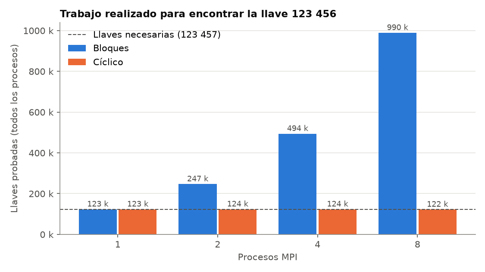

4. **El reparto cíclico elimina la dependencia de la llave.** Como cada proceso recorre el
   espacio "intercalado" con los demás, todos avanzan juntos desde 0 hacia arriba, y el
   que tenga la llave la alcanza tras ≈ k/N iteraciones. El speedup es ≈ N y la eficiencia
   ≈ 1 para cualquier llave (hasta 4 procesos). El trabajo total siempre es ≈ k + 1
   llaves, el mismo que la versión secuencial: no hay trabajo desperdiciado.

5. **La llave del código original es un ejemplo extremo.** `the_key = 2⁵⁴` en un espacio
   de 2⁵⁶. Con N = 4, el bloque del proceso 1 empieza exactamente en 2⁵⁶/4 = 2⁵⁴: si el
   programa funcionara, la llave se encontraría **en la primera iteración** (lo confirma la
   salida de la sección 3.2: `Process 1 lower 18014398509481984`). Con N = 8 pasaría lo
   mismo (inicio del bloque de P2). En cambio, con N = 2 o N = 3, la llave cae en el bloque
   del proceso 0 a distancia 2⁵⁴, y a ~26 800 llaves/s tardaría unos **21 000 años**. El
   mismo programa con la misma llave pasa de instantáneo a impracticable al cambiar solo
   el número de procesos.

6. **El tiempo base crece con el valor de la llave.** Esto vale para ambos repartos. En
   el cíclico, la búsqueda avanza desde 0, así que una llave grande siempre toma más que
   una pequeña: 0.70 s para 123 456 contra 6.14 s para 1 048 575, con 8 procesos. En un
   escenario real, donde la llave es aleatoria en [0, 2⁵⁶), el tiempo esperado corresponde
   a recorrer la mitad del espacio.

### 7.4 Límite de 8 procesos en este equipo

Con 8 procesos, la eficiencia del reparto cíclico cae de ~1.0 a ~0.78. El problema es
perfectamente paralelo (los procesos no se comunican mientras buscan), así que la causa
es el hardware:

- El i7-13700HX tiene 8 núcleos de rendimiento y 8 de eficiencia, que son más lentos. WSL
  no garantiza que los 8 procesos queden en núcleos de rendimiento.
- Con más núcleos activos, el procesador baja la frecuencia de turbo de cada núcleo.

Esto se nota en la última columna de la tabla de 6.2: con 8 procesos cíclicos, la suma de
llaves probadas (122 450) es algo menor que k + 1 = 123 457. El proceso que encontró la
llave avanzó más rápido que algunos de sus compañeros.

### 7.5 Escala real de DES

A la velocidad medida (≈ 26 800 llaves/s por proceso), recorrer las 2⁵⁶ llaves tomaría:

| Procesos | Tiempo para todo el espacio | Tiempo esperado (mitad del espacio) |
|---:|---:|---:|
| 1 | ≈ 85 000 años | ≈ 42 600 años |
| 8 (speedup 6.2) | ≈ 13 700 años | ≈ 6 900 años |

Por eso el análisis se hizo con un espacio de 2²⁰. Los ataques reales contra DES usaron
hardware dedicado (*Deep Crack*: ~9 × 10¹⁰ llaves/s) y, además, verificaban cada llave
descifrando un solo bloque. Este programa descifra el texto completo (291 bloques) en
cada `tryKey`. Descifrar solo los primeros bloques y descartar la llave si no producen
texto válido aceleraría la búsqueda cerca de dos órdenes de magnitud.

---

## 8. Conclusiones

1. DES cifra bloques de 64 bits con una red de Feistel de 16 rondas y una llave efectiva de
   56 bits. Ese tamaño de llave es su principal debilidad: un ataque de fuerza bruta es
   viable con suficiente hardware, y el problema es naturalmente paralelo porque cada
   llave se prueba de forma independiente.
2. El código entregado no compila en distribuciones actuales porque glibc eliminó
   `rpc/des_crypt.h`. Un header de compatibilidad sobre OpenSSL lo resuelve sin cambiar el
   código. Además, el código tenía defectos (longitud fija de 16 bytes, frase de búsqueda
   que no coincide, desbordamiento en la expansión de la llave, bloqueo si no se encuentra
   la llave) que impedían que encontrara la llave.
3. Con el reparto por bloques, el speedup depende de la llave y no del número de procesos:
   en las mediciones fue desde 0.77× hasta 516×. Los speedups superlineales son aparentes,
   y varias llaves no obtienen ningún beneficio del paralelismo.
4. El reparto cíclico da un speedup consistente, ≈ N (2.0×, 3.9×, 6.2× con 2, 4 y 8
   procesos), para cualquier llave, y no desperdicia trabajo. Para evaluar el rendimiento
   de un programa paralelo de búsqueda conviene medir con varias llaves y preferir un
   reparto cuyo comportamiento no dependa de dónde está la solución.
5. Más allá de 4 procesos, la eficiencia en este equipo baja a ~0.78 por su arquitectura
   híbrida de núcleos, no por el algoritmo.
